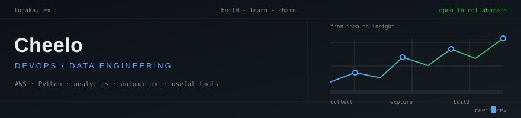

  

  

  
  
  
  
  
  

---

DevOps and data engineer based in Lusaka, Zambia. I enjoy building practical
things with software, cloud technologies, and data: automation that saves time,
dashboards that make information easier to use, and applications that explore
local challenges.

My projects span cloud learning, analytics, and application development. I’m
currently deepening my AWS knowledge and exploring how thoughtful automation
and data-driven tools can make everyday work better.

## What I work with

**Cloud and DevOps** — AWS, Docker, Kubernetes, Terraform, Jenkins, and Linux.

**Data and analytics** — Python, Jupyter notebooks, Streamlit, and Power BI.

**Development and automation** — TypeScript, JavaScript, C#, and PowerShell.

**Databases and observability** — MongoDB, PostgreSQL, Grafana, and Prometheus.

## A few things here

**[CropAI Zambia](https://github.com/ceethedev/AI-for-Early-Crop-Disease-Detection)** — A web application exploring early crop disease detection for Zambian farmers, with farmer surveys and educational content. The disease analysis is currently a prototype.

**[Toyota GR Cup Race Analytics Dashboard](https://github.com/ceethedev/Toyota-GR-Cup-Race-Analytics-Dashboard)** — A Streamlit dashboard for exploring race telemetry, comparing driver performance, and simulating race strategy.

**[National Athlete Performance Platform](https://github.com/ceethedev/National-Athlete-Performance-Data-Platform)** — A data analytics project focused on athlete performance, training and recovery, injury prevention, and talent identification.

**[PowerShell Scripts](https://github.com/ceethedev/Powershell_scripts)** — Practical scripts for workplace automation.

**[Zambia Net Pay](https://github.com/ceethedev/zambia-net-pay)** — A simple calculator for Zambian tax bands.

These projects reflect the kind of work I enjoy: learning by building, using
data to make a question clearer, and turning useful ideas into tools people can
try.

## How I work

- Start with the problem and keep the solution understandable.
- Build in small steps and learn from feedback.
- Use automation where it makes repeated work simpler.
- Treat data carefully and be clear about prototype limitations.
- Stay curious: there is always another tool or idea worth exploring.

## Learning and community

- Deepening my knowledge of **AWS cloud architecture** and DevOps practices.
- Creating and sharing templates on [Miroverse](https://miro.com/miroverse/profile/cheelo-hamududu/).
- Writing and sharing ideas on [Hashnode](https://hashnode.com/@ceethedev).
- Based in **Lusaka, Zambia** and open to collaborating on useful projects.

## 📊 Activity

  
  

  

## Contact

Explore my [repositories](https://github.com/ceethedev) or connect with me on
[Linkedin](https://www.linkedin.com/in/cheelo-hamududu/). I’m happy to talk about cloud,
automation, data projects, and ideas worth building.

---

Always learning, always building.
